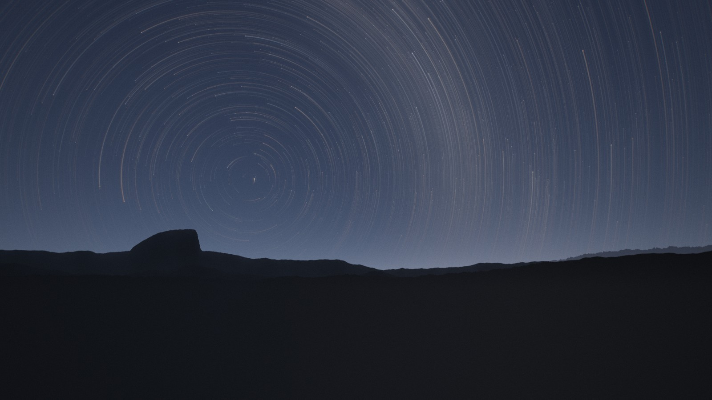

# Star Trails



A live wallpaper for Windows that looks like a long-exposure star-trail
photograph. The real night sky turns slowly around the north celestial pole,
which sits low over a mountain horizon. Every star leaves an arc. The frame
has film grain, lens glow, atmospheric extinction and a faint Milky Way.

Nothing here is a canned animation. Each star is a real catalogue star at its
true position, and the sky starts as it actually is right now from the chosen
latitude and longitude. After that, time runs faster than real time.

## Installing as a wallpaper

1. Install [Lively Wallpaper](https://github.com/rocksdanister/lively) (free).
2. In Lively, choose **Add Wallpaper → Browse** and pick this folder, or drag
   the folder onto the Lively window. Lively finds it through `LivelyInfo.json`.
3. Right-click the wallpaper → **Customize**. Every setting applies live:

| Setting | What it does |
| --- | --- |
| Rotation speed | ×20 to ×4000 real time. The default turns the sky once every ~5 minutes. |
| Star trails | On/off. Trails fade in and out smoothly. With trails off, stars are twinkling points that still rotate. |
| Trail length | 5° to 180° of sky rotation. |
| Trail style | **Comet** fades toward the tail. **Exposure** is an even arc, like a stacked long exposure. |
| Build trails up from start | Trails grow from nothing, as if the shutter just opened. |
| Constellation lines / names / opacity | Constellation figures that turn with the sky. |
| Faintest star | Limiting magnitude, from 4.0 (city sky) to 8.0 (remote dark site). |
| Exposure, Film grain | The camera look. |
| Latitude | Height of the pole above the horizon. Lower puts it nearer the horizon line. |
| Longitude | Only decides which stars are up at the start. |
| Milky Way glow, Mountain silhouette | Scene layers. |
| Mirror composition | Moves the pole from the left third of the frame to the right third. The landscape mirrors with it; the sky stays astronomically correct. |
| Field of view, Frame rate, Render scale | Framing and performance. Lower the render scale on integrated graphics. |
| Open the shutter again | Restarts the trail build-up. |

## Running explore.html

ES module imports are blocked over `file://`, so serve the folder over HTTP:

```bash
npx serve -l 8000 .
```

Then open <http://localhost:8000/explore.html>. A panel generated from
`LivelyProperties.json` drives the same settings; press <kbd>H</kbd> to hide
it. `?t=2026-09-22T15:00:00Z` pins the start time, and `?still` hides the
panel and shows full-length trails immediately (useful for screenshots).
`serve.json` turns off clean-URL redirects, which would otherwise drop these
query strings.

## How it works

- **Real data.** `data/stars.js` holds 41,487 stars down to magnitude 8 from
  the HYG Database v4.1 (Hipparcos + Yale Bright Star + Gliese): RA, Dec,
  magnitude and B−V colour, sorted by brightness. The star-density setting
  therefore only changes a draw count. `data/constellations.js` holds the
  constellation figures from d3-celestial. Both files are generated by
  `node tools/build-catalog.mjs`, and the output is committed.
- **Real sky motion.** Local sidereal time is computed from the clock and
  longitude. Each star's hour angle, declination and your latitude become an
  altitude/azimuth direction in the vertex shader. The camera faces due north.
  It is solved numerically so that the pole lands about a third of the way in
  from one side and a little above the middle.
- **Trails are drawn exactly, not built up by stacking frames.** Each star is
  one instance of a ribbon strip. The vertex shader places each strip vertex
  along the star's diurnal circle, from where the star is now back to where it
  was `trailLength` degrees ago, and widens the ribbon in screen space. The
  result is independent of framerate, and changing speed, length or style
  applies instantly.
- **Photographic brightness.** Energy follows a stretched flux curve
  (flux^0.62), much as a processed long exposure lifts faint stars. A trail's
  exposure per pixel goes as 1/cos(dec), so slow circumpolar stars burn
  brighter arcs. Each ribbon has a Gaussian profile, with a minimum width so
  faint stars stay fine hairlines. B−V is converted to colour temperature and
  then to RGB, and desaturated like a camera's white balance. Kasten-Young
  airmass dims stars near the horizon and shifts them red.
- **Camera pipeline** (`js/post.js`): a quarter-resolution sky (airglow
  gradient, a faint town glow, and a Milky Way computed in galactic
  coordinates and smeared along the same arc as the trails) → HDR half-float
  scene → dual-Kawase bloom → composite. The composite draws three layered
  procedural ridgelines, including a Half Dome-like monolith, then applies an
  ACES tone curve, vignette, lateral chromatic softness, 24 fps film grain and
  dithering.

## Data and licences

- Code: MIT. See [LICENSE](LICENSE).
- Star catalogue: [HYG Database](https://github.com/astronexus/HYG-Database),
  CC BY-SA 4.0.
- Constellation figures: [d3-celestial](https://github.com/ofrohn/d3-celestial),
  BSD-3-Clause.
- `vendor/three/`: Three.js r0.185.1, MIT. See `vendor/three/LICENSE`.
